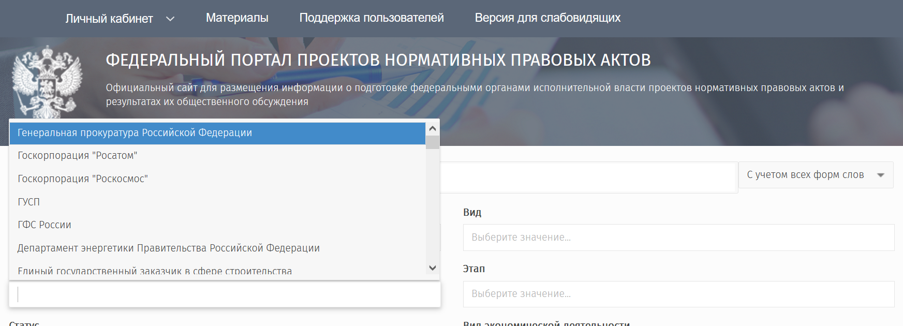

# Соседние формы

Государственная НКО в этой книге — не любая организация рядом с государством. Ниже три соседние формы, которые в прежней раскладке легко попадали в ту же классификацию.

## Бюджетное учреждение

Некоммерческий статус даёт органу власти возможности, которых нет у бюджетного учреждения. Учреждение входит в организации бюджетной сферы. Определение этого круга — в главе [«Закон об НКО»](../05-regulation/02-nko-law.md): государственные и муниципальные учреждения, органы власти, органы управления внебюджетными фондами.

Учреждение закупает по 44-ФЗ. Сведения о нём рассчитаны на раскрытие, в том числе через портал государственных и муниципальных учреждений [bus.gov.ru](https://bus.gov.ru/). Оплата и режим работы ограничены. Государственная НКО из этого круга выходит. Наглядный переход — реорганизация ФГБУ «Аналитический центр при Правительстве Российской Федерации» в АНО. Он разобран в главе [по учредителю](../04-classification/02-by-founder.md).

## Государственная корпорация

В прежней классификации госкорпорации стояли внутри государственных НКО: у части из них есть полномочия органов власти. Здесь они вынесены в соседнюю форму. Это не организация, которую создали по закону об НКО вместо учреждения, чтобы выйти из закупок и раскрытия.

Ограниченный круг госкорпораций действительно осуществляет властные полномочия, включая лицензирование.

:::note
По пункту 2 статьи 14 Федерального закона от 13 июля 2015 г. № 215-ФЗ и части 55 статьи 12 Федерального закона от 4 мая 2011 г. № 99-ФЗ «О лицензировании отдельных видов деятельности» Государственная корпорация по космической деятельности «Роскосмос» оказывает государственную услугу [«Лицензирование космической деятельности»](https://www.roscosmos.ru/22364/).

Роскосмос и Росатом разрабатывают нормативно-правовые акты и проводят их публичное обсуждение на [федеральном портале проектов нормативных правовых актов](https://regulation.gov.ru).

:::

Госкорпорация «Ростех» таких нормативно-правовых полномочий не имеет. Значит, даже внутри госкорпораций властный мандат — не общее свойство.

Организации, которые публикуют совместные приказы с Минспортом России и при этом не являются госкорпорациями, остаются в классификации [по мандату](../04-classification/03-by-mandate.md).

## Компания с государственным участием

ПАО, АО и ООО с контрольным пакетом государства — не предмет книги. Они сами бывают учредителями НКО. Такой НКО попадает в ось [«по учредителю»](../04-classification/02-by-founder.md). Закупки самой компании идут по 223-ФЗ. Закупки учреждённой ею НКО — нет. Это различие разобрано в главе [«Закупки»](../05-regulation/04-procurement.md).

Деньги, которые компания перечисляет НКО как пожертвование, — отдельный и плохо видимый канал. Один разобранный случай — в главе [о пожертвованиях](../06-finance/05-donations.md).

## Источники

- 402-ФЗ «О бухгалтерском учёте» — определение организаций бюджетной сферы, в главе о [законе об НКО](../05-regulation/02-nko-law.md).
- 99-ФЗ «О лицензировании отдельных видов деятельности», 215-ФЗ — полномочия Роскосмоса.
- [regulation.gov.ru](https://regulation.gov.ru), [bus.gov.ru](https://bus.gov.ru/).
