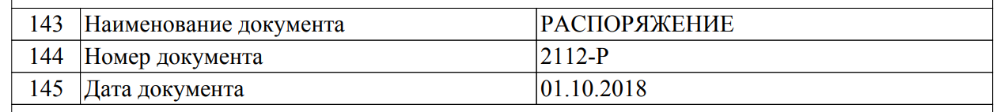

# Как узнать государственную НКО

Чёткой методики, которая даёт одно число государственных НКО, нет.

Ориентир рукописи: не меньше **500** и не больше **12 000** организаций. Вилка такая широкая, потому что три способа учёта считают разные круги. Классификация ниже имеет смысл только вместе с пометкой, каким способом организация попала в круг.

## Отметка в ЕГРЮЛ

**48 НКО** на федеральном уровне и **454 НКО** в подчинении властей субъектов имеют соответствующую отметку в ЕГРЮЛ. Это организации, у которых учредитель — орган власти, и уровень власти указан кодом:

- 1 — Российская Федерация
- 2 — субъект федерации
- 3 — местное самоуправление

Код не покрывает все организации, созданные органами власти. У Агентства стратегических инициатив единственный учредитель — Правительство Российской Федерации, а признака с кодом «Российская Федерация» нет. Таких примеров много. Как регистрация ставит и не ставит эту отметку — в главе [«Регистрация»](../05-regulation/03-registration.md).

## Цепочка учредителей

У большинства организаций в ЕГРЮЛ есть учредители. Основной способ идентификации — разбор цепочки учредителей.

По классификации проекта «Открытые НКО» (openngo.ru) к НКО с государственными учредителями отнесены:

- **2947 НКО** в подчинении федеральной власти
- **2756 НКО** в подчинении властей субъектов
- **5684 НКО** в подчинении местного самоуправления

Организация может входить в несколько групп. Микрокредитная компания Тульской области «Областной фонд поддержки малого предпринимательства» учреждена Правительством Тульской области и Федеральным фондом поддержки малого предпринимательства.

Часть НКО так не опознать: учредителей в ЕГРЮЛ нет. Российский научный фонд — один из крупнейших получателей бюджетного финансирования, учреждён федеральным законом, а принадлежность Российской Федерации как учредителя в ЕГРЮЛ не отражена.

В этот список попадают и ассоциации, где рядом с государством есть физические лица и коммерческие компании. Список нужно проверять дальше.

## Учреждающий документ

Многие, но не все, государственные НКО создаются законом, постановлением или поручением. Российский научный фонд создан [федеральным законом «О Российском научном фонде и внесении изменений в отдельные законодательные акты Российской Федерации» от 02.11.2013 № 291-ФЗ](https://rg.ru/documents/2013/11/06/nauch-fond-dok.html).

Полный разбор нормативно-правовой базы за 20 лет был бы отдельной работой. Обходной путь: в первой записи ЕГРЮЛ есть основание регистрации. У государственных НКО там часто указан федеральный закон или постановление.

В ЕГРЮЛ **1539 НКО** со ссылкой на федеральные законы и постановления. Этот список почти не покрывает НКО, созданные государственными организациями. В него не входит АНО «ТВ Новости», дочерняя организация ФГУП «Россия сегодня» и крупнейший получатель субсидий из федерального бюджета. Через постановления создают и многие профсоюзные, и даже религиозные организации.

Много НКО создаётся распоряжениями. Фонд жилищного строительства Ямало-Ненецкого автономного округа создан Департаментом строительства и жилищной политики ЯНАО по распоряжению Правительства Ямало-Ненецкого автономного округа от 24 июля 2010 года № 50-РП.

При регистрации АНО «Центр изучения и сетевого мониторинга молодёжной среды» (АНО «ЦИСМ») указано, что оно создано по распоряжению 2112-Р от 1 октября 2018 года. Такого распоряжения нет в открытом доступе ни у Правительства России, ни у Федерального агентства по делам молодёжи, которое выступает учредителем.

:::note
Это распоряжение есть в официальной выписке ЕГРЮЛ. Его можно найти на [egrul.nalog.ru](https://egrul.nalog.ru) по ИНН 9709037529, строки 143–145.

:::

По дате регистрации и по другим распоряжениям 2010–2019 годов с номером 2112-Р это распоряжение Правительства Российской Федерации. На сайте Правительства его [нет](http://government.ru/docs/all/?type=102000066_102000499&number=2112-%D0%A0&text=&dt=&dt.till=&dt.since=).

Агентство стратегических инициатив, напротив, создано распоряжением, которое открыто: [распоряжение Правительства РФ от 11 августа 2011 г. № 1393-р](http://www.pravo.gov.ru/proxy/ips/?doc_itself=&nd=102149871).

## Преобладающее бюджетное финансирование

Этот способ не даёт отдельного подсчёта в книге. Он нужен там, где учредитель не государство, а деньги почти целиком бюджетные.

Учредителями могут быть физические лица или организации вне государства. В правлении может не быть лиц, принимающих решения на госслужбе. В мировой практике такой круг называют ГОНГО. Определение и отличие от государственной НКО по учредителю — в главе [«Что такое государственная НКО»](../02-boundary/01-what-it-is.md).

Причины бывают разные, часто это регулярные мероприятия, которые поддерживают и государственные, и негосударственные организации. Формально статус негосударственный, а раскрытие обычно ограничено контактами, реквизитами и уставом.

:::tip[Пример]
[АНО «Фестиваль „Золотая маска“»](https://www.goldenmask.ru/) получает преобладающее финансирование из федерального бюджета и возможную поддержку из других бюджетов, в том числе бюджета Москвы.

[Учредители](https://openngo.ru/organization/1057749236984/) — Всероссийское театральное общество и трое физических лиц.
:::

## Служащие в органах управления

Представитель государства может входить в правление, попечительский или наблюдательный совет. Закон о гражданской службе такое безвозмездное участие разрешает. Наличие служащего в органе — слабый и труднодоказуемый признак: отдельной переписи по нему в книге нет. Правовое следствие разобрано в главе [«Конфликт интересов»](../05-regulation/05-conflict.md).

## Зачем нужно число

Более точная методика должна начинаться с цели подсчёта. Наиболее вероятная цель — учёт организаций, на которые распространяют требования отчётности, открытости и хозяйственной деятельности.

## Источники

- ЕГРЮЛ, сервис [egrul.nalog.ru](https://egrul.nalog.ru).
- Проект «Открытые НКО», [openngo.ru](https://openngo.ru/).
- Федеральный закон от 02.11.2013 № 291-ФЗ.
- [pravo.gov.ru](http://www.pravo.gov.ru/proxy/ips/?doc_itself=&nd=102149871), [government.ru](http://government.ru/).
