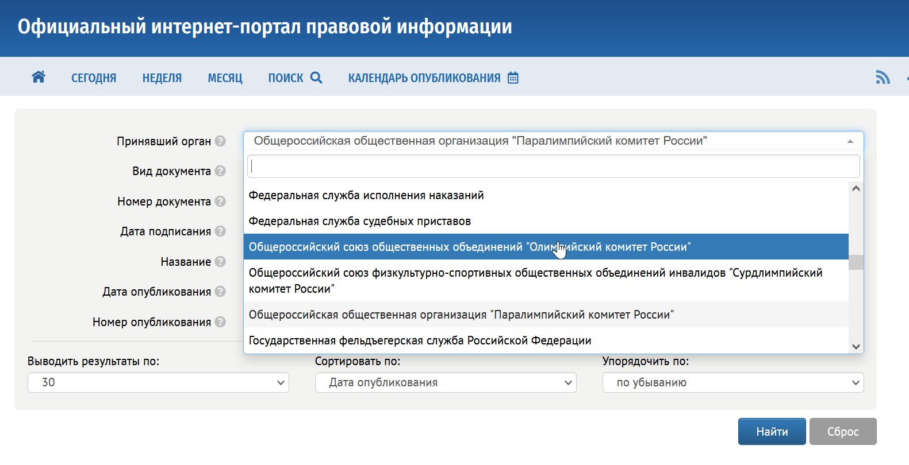

# По мандату

Помимо учредителя, государственная НКО бывает втянута в функцию государственного управления или в поручение органа власти.

Роль может быть закреплена нормативно-правовым актом. Может следовать из официального документа без статуса такого акта: поручения, решения комиссии. Организация может просто получать бюджетные деньги и не иметь закреплённой роли. Последний случай — не мандат. Если при этом бюджет преобладает, организация опознаётся [по финансированию](../03-identification/01-methods.md).

Группы в этой главе:

- полномочия, которые организация осуществляет вместе с органом власти;
- функции, закреплённые нормативно-правовым актом, в том числе без государственного учредителя;
- деятельность по официальным документам, которые не являются нормативно-правовыми актами;
- отсутствие и нормативного, и иного закрепления.

Госкорпорации с лицензионными и нормотворческими полномочиями в этот список не входят. Они разобраны как [соседняя форма](../02-boundary/02-neighbors.md).

## Полномочия вместе с органом власти

Часть некоммерческих организаций публикует совместные приказы с Минспортом России:

- Общероссийский союз общественных объединений «Олимпийский комитет России»;
- Общероссийский союз физкультурно-спортивных общественных объединений инвалидов «Сурдлимпийский комитет России»;
- Общероссийская общественная организация «Паралимпийский комитет России».

:::note
Эти организации перечислены на официальном интернет-портале правовой информации. По каждой есть приказы, подготовленные вместе с Минспортом России.

:::

## Функции, закреплённые нормативно-правовым актом

Значительная часть организаций создаётся специальным законом, постановлением или распоряжением.

:::tip[Пример]
[Российский научный фонд](https://rnf.ru) создан федеральным законом [«О Российском научном фонде и внесении изменений в отдельные законодательные акты Российской Федерации» от 02.11.2013 № 291-ФЗ](https://rg.ru/documents/2013/11/06/nauch-fond-dok.html).
:::

Цель обычно задаёт орган, принявший акт: ежегодное мероприятие, гранты определённой группе. К этому кругу рукопись относит:

- Российский научный фонд;
- Фонд президентских грантов;
- Президентский фонд культурных инициатив;
- и другие организации того же способа создания.

:::note
Открытость таких организаций чаще всего задают акт о создании и устав. Общих требований к открытости нет.
:::

Сам акт редко устанавливает, что организация должна раскрывать. [Президентский фонд культурных инициатив](https://xn--80aeeqaabljrdbg6a3ahhcl4ay9hsa.xn--p1ai/) создан 17 мая 2021 года [указом Президента РФ № 287](http://kremlin.ru/acts/news/65593). Указ не задаёт требований к открытости. Фактически фонд открыт настолько, насколько это решает утверждённый указом координационный совет.

Отдельный подвид — мандат есть, а государственного учредителя нет.

:::tip[Пример]
[Фонд информационной демократии](https://www.f-id.ru/), оператор сайта Российской общественной инициативы (roi.ru), имеет одного учредителя — физическое лицо. Статус закреплён [указом Президента Российской Федерации от 04.03.2013 № 183](http://kremlin.ru/acts/bank/36853) «О рассмотрении общественных инициатив, направленных гражданами Российской Федерации с использованием интернет-ресурса „Российская общественная инициатива“».

У организации есть поручение и непубличная форма государственной финансовой поддержки. По учредителю она государственной не является.
:::

Таких организаций относительно немного. Государство редко передаёт функцию, не сохраняя прямого контроля. Про неформальный контроль при выдаче «государственного мандата» можно только предполагать: отдельного источника в книге нет.

## Официальные документы без статуса нормативно-правового акта

Ряд организаций создан не органом власти, а компанией с государственным участием или бюджетным учреждением. Иногда государство изначально и не было учредителем. При этом организация связана с государственной, в том числе нормотворческой, работой. Государственного финансирования и нормативного статуса может не быть.

:::tip[Пример]
[АНО «Цифровая экономика»](https://data-economy.ru/) сначала учредили крупные коммерческие компании, госкорпорации и компании с госучастием. В 2020 году [распоряжением Правительства РФ от 28 октября 2020 года № 2790-р](http://government.ru/docs/40740/) она получила полномочие представлять предпринимательское сообщество. Ранее Правительство РФ вошло в состав учредителей.

До вхождения Правительства организацию можно было описывать как лоббистскую: через неё крупные цифровые компании продвигали свои интересы. С участием Правительства она стала ещё одной специализированной НКО для проведения государственной политики. Функция продвижения интересов крупного бизнеса при этом могла сохраниться.
:::

## Без нормативно-правового и иного закрепления

Часто особого правового статуса нет. Организацию учреждает бюджетное учреждение или компания с госучастием решением единственного учредителя. Такие организации остаются на оси [учредителя](./02-by-founder.md). Отдельного мандата у них нет.

## Источники

- Федеральный закон от 02.11.2013 № 291-ФЗ.
- Указ Президента РФ от 17.05.2021 № 287; указ от 04.03.2013 № 183.
- [Распоряжение Правительства РФ от 28.10.2020 № 2790-р](http://government.ru/docs/40740/).
- [pravo.gov.ru](http://pravo.gov.ru) — совместные приказы с Минспортом.
